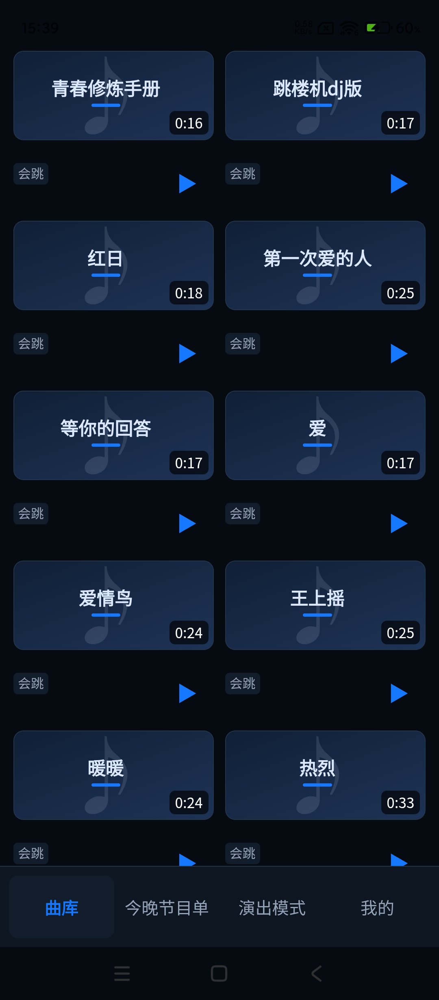
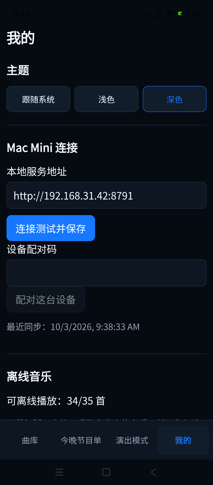
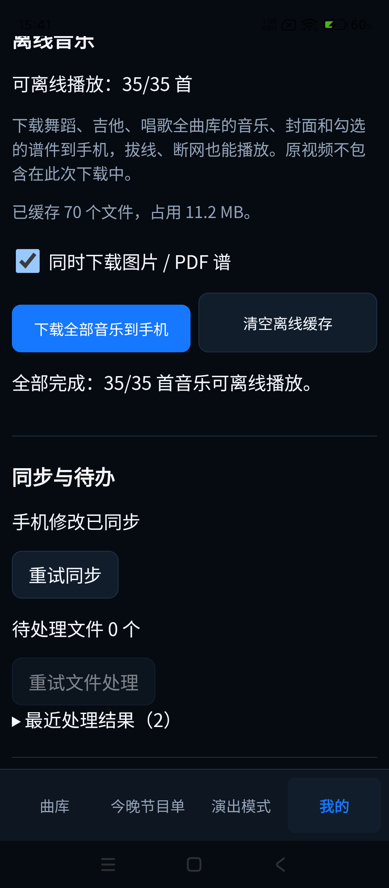

# Talent Showcase

Keep the songs you practise, their scores, and what you need on stage in one local library. Rehearse with looping and tempo changes from your own computer, then cache tonight's set onto your phone before you leave.

[简体中文](./README.md) | English

<p>
  
  
  
</p>

## What it solves

Practice material is usually scattered: audio lives in a music app, scores live in a photo album or PDF, original key, performance key, and capo settings live in a notes app, and tonight's running order lives in a chat thread. To work on one line, you end up dragging a progress bar back and forth.

This app puts audio, scores, lyrics, keys, practice status, and performance order into one local library. While practising you can loop a line or a section, change tempo between 0.75x and 1.5x, and jump by line. Before a show you cache the selected songs, lyrics, scores, and reference videos onto the phone, so playback works even where the network is unreliable.

## Core capabilities

### Three libraries

- Four main entries at the bottom: Dance, Vocal, Guitar, and Mine.
- Vocal and guitar entries can store original key, performance key, text scores, and notes; guitar entries also have a capo field.
- Learning status is shared across libraries: want to learn, practising, and can sing / can play. Vocal entries can be filtered by language; guitar entries by scene.
- Search, batch management, batch classification edits, move to trash, and restore are supported.
- Scores are stored as PDF or image attachments. The built-in reader supports page navigation and 0.25x zoom steps, and remembers the page per song.

### Importing and organising

- Vocal batch import accepts mp3, m4a, wav, and flac audio plus `.lrc` lyrics, with a preview and correction step before saving.
- Local smart import (off by default) can scan a controlled music directory, separate original vocals from accompaniment, and extract lyrics and structure. When no allow-listed directory is configured, the endpoints are not mounted.
- Covers, audio, scores, and reference videos all come from the local server, and the phone downloads them on demand.
- Deletion moves items to trash for recovery. Batch and single-item operations share the same server endpoints.

### Vocal practice

- Line loops offer only 3-line and 5-line ranges, alongside whole-song loops, section loops, and a "run the duet once" action.
- Tempo steps are 0.75x, 1x, 1.25x, and 1.5x; pitch is preserved while changing speed.
- Backward and forward jumps are selectable at 5, 10, 15, and 30 seconds. Lyrics can be tapped to seek and scroll line by line.
- Lyric size has standard, large, and extra-large levels. Translations can be toggled per line, with redundant translations marked.
- The song map splits the track into intro, verse, chorus, bridge, and other sections. Rap ranges can be selected and skipped; unconfirmed rap sections are called out separately.
- Immersive practice mode hides list controls and leaves only playback and lyrics.
- An A4 study sheet can be generated. Paper revision import is used to bring handwritten changes back into lyrics and structure.

### Vocal performance and running order

- Tonight's running order mixes dance, vocal, and guitar items, supports drag reordering and up/down buttons, and saves the order.
- Performance mode is a single-column phone layout. Vocal items default to the accompaniment track; when it is missing, the app says so instead of silently playing the original vocal.
- During a performance you can switch between original and accompaniment while keeping the play position, pause state, and lyric sync. The screen stays awake.
- Preparing an offline show lists each gap per song: accompaniment missing, accompaniment not cached, lyrics without timestamps, structure not annotated. It does not hide missing pieces behind an "already prepared" label.
- Guitar scores, dance audio, and reference videos use the same offline preparation flow.

### Song requests by QR code

- Under "Mine → Song Requests", choose which songs may be published and generate a QR code. Nothing is published by default.
- Guests on the same Wi-Fi open the request page and see only the selected song titles and talent type, never scores, lyrics, notes, or media.
- A request takes a nickname (up to 40 characters) and a note (up to 200 characters). The same song is not queued twice.
- A request session expires after 24 hours by default and can be closed early. The host can accept, reject, or clear processed requests; accepted songs are added to the running order.

### Android offline shell

- Capacitor 8 packs the built frontend and native capabilities into the APK. Android playback uses verified local files rather than a live server.
- The Mine page shows the number of cached items and bytes used, can prepare the "want to learn" and "tonight's running order" sets in one action, and can clear offline media.
- After a cold start with no network, the library still opens and cached songs still play. Scores, lyrics, and reference videos count as available only after a download passes verification.

## Quick Start

Requires Node.js 22 or later and npm. The server does not read a `.env` file, so environment variables must be exported in the shell.

```bash
npm ci
npm run dev          # frontend, default http://127.0.0.1:5173
npm run server:dev   # API, default http://127.0.0.1:8791
```

The first start creates the SQLite database `var/personal-dance-library.db` and the media directory `var/media` under `var/`, and automatically applies pending migrations. If you already have real data, confirm that `SQLITE_DB_PATH` points at the database you intend to operate on.

Health check:

```bash
curl --noproxy '*' http://127.0.0.1:8791/api/health
```

The expected response is `{"ok":true,"recognition":"disabled"}`.

Checks and build:

```bash
npm run lint
npm run typecheck
npm test
npm run test:integration
npm run build
```

Database scripts:

```bash
npm run db:migrate
npm run db:backup
npm run db:restore
```

Docker:

```bash
docker build -t dance-library .
docker run --rm -p 8791:8791 -v "$(pwd)/var/docker:/app/data" dance-library
```

Android debug build:

```bash
npm run build
npx cap sync android
cd android && ./gradlew :app:assembleDebug
```

Building requires JDK 21 and the Android SDK; the repository's verification notes record that JDK 17 fails. The APK is at `android/app/build/outputs/apk/debug/app-debug.apk`, and the debug package name carries a `.dev` suffix.

Connecting a phone to the local server:

```bash
HOST=0.0.0.0 PORT=8791 npm run server:dev
```

In the app's "Mine" page, enter the computer's LAN address (for example `http://192.168.x.x:8791`) and the device pairing code. On first start the server generates `owner-pairing.json` next to the database. Devices on the same home LAN or Tailscale range pair automatically; only cross-subnet devices need the code entered manually.

Live reload on a device (optional):

```bash
CAP_LIVE=1 npx cap sync android
adb reverse tcp:5173 tcp:5173
adb reverse tcp:8791 tcp:8791
```

Start the app and the WebView loads the local Vite server, so JS changes apply immediately.

## Data and privacy

- The library, scores, lyrics, structure, and running order live in a local SQLite database; media files live under `MEDIA_ROOT`. There is no account, cloud sync, or third-party backup.
- The phone connects to your own server over LAN or Tailscale. Pairing credentials stay on the device, and the pairing code is only used to establish trust.
- QR song requests expose only the titles and talent types you selected. The page returns no scores, lyrics, notes, or media. Sessions expire after 24 hours by default and can be closed early.
- If lyric translation is enabled, the original lyrics are sent to the CodeBuddy cloud model; the repository explicitly documents that this is not a local model. Without a configured `scripts/codebuddy-auto.sh`, translation fails explicitly rather than returning fake output.
- Music recognition is disabled by default (`MUSIC_RECOGNITION_PROVIDER=disabled`). The repository provides only a provider interface and a mock for tests, with no built-in cloud recognition implementation.
- Local smart import reads only allow-listed directories declared by the server and treats source directories as read-only. Outputs go to `MEDIA_ROOT/vocal-import/`; source files are not moved, renamed, or deleted.
- The Android shell uses cleartext HTTP inside a private network (`androidScheme: http`) so pages can load LAN media and APIs. Do not treat this build as a public-internet client.

## Known limitations

- The frontend has no Service Worker and is not an installable browser PWA. Offline playback depends on the Android shell's local file cache; the browser build needs the server online.
- Original key, performance key, and capo are records only. They do not transpose the audio; tempo changes preserve pitch rather than shift it.
- Local smart import is off by default and requires an allow-listed directory, ffmpeg / ffprobe, an executable `audio-separator`, and model files. Structure analysis also needs a separate Python venv. If any piece is missing, work stops in an explicit pending state.
- There is no single version number in the repository: `package.json` says 0.1.0, the Android shell is currently 1.1.32 (versionCode 35), and the release record stops at v1.0.0. The native version in `android/app/build.gradle` is authoritative.
- The Android package is debug-signed with `applicationId` `com.wanghoufan.dancelibrary`; debug builds carry a `.dev` suffix. There is no store release configuration and no iOS project.
- A Node server must be running on macOS. The phone does not host the library, so if the address changes after switching networks, update the server or fallback address in "Mine".
- QR song requests require guests and the computer to be on the same network. If the public address is unavailable, the QR code cannot be opened.

The version injection, build chain, and artifact verification method are documented in `docs/architecture-facts.md`. Enablement and recovery steps for local import are in `docs/vocal-v31-operations.md`.
