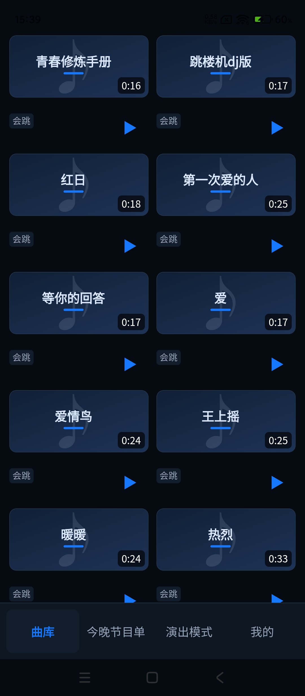
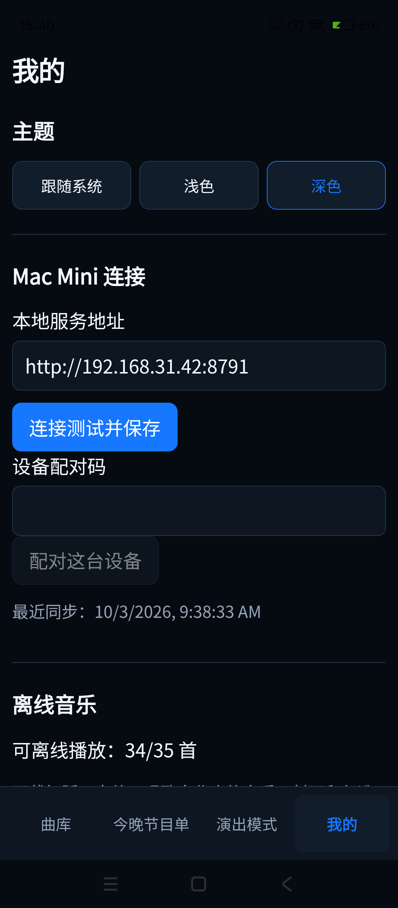
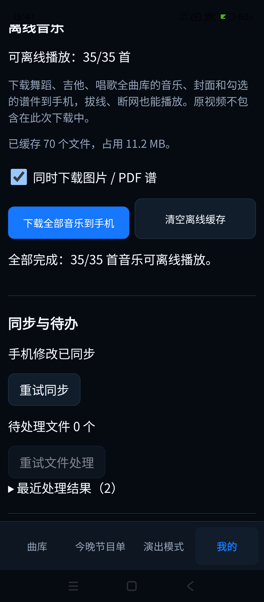

# 才艺展示厅

自己练的歌、谱和现场要用的东西收在一个本地曲库里，连上自家电脑循环变速练唱，出门前把今晚的曲目装进手机离线带走。

[English](./README.en.md)

<p>
  
  
  
</p>

## 它解决什么问题

练歌和上台时，资料通常是散的：音频在音乐软件里，谱在相册或 PDF 里，原调、演出调和变调夹记在备忘录里，今晚的顺序写在聊天记录里。想单独抠某一句，只能在播放器里来回拖进度条。

这个应用把音频、谱、歌词、调性、练习状态和演出顺序放进同一个本地曲库。练唱时可以按句或按段循环、0.75–1.5 倍变速、逐句点跳；演出前把选定曲目、歌词、谱和参考视频缓存到手机，到了没有稳定网络的场地也能直接播。

## 核心能力

### 三个曲库

- 底部四个主入口：舞蹈、唱歌、吉他、我的。
- 唱歌与吉他曲目可记录原调、演出调、文本谱和备注；吉他另有 Capo 字段。
- 学习状态统一为想学、正在练、会唱 / 会弹；唱歌支持按语言筛选，吉他支持按场景筛选。
- 支持搜索、批量管理、批量修改分类、移入回收站与恢复。
- 谱以 PDF 或图片附件保存，内置阅读器支持翻页与 0.25 倍步进缩放，并按曲目记住页码。

### 收录与整理

- 唱歌批量导入接受 mp3、m4a、wav、flac 音频与 `.lrc` 歌词；导入前可预览与校对。
- 本地智能导入（默认关闭）可从受控音乐目录扫描，分离原唱与伴奏、提取歌词与结构；未配置白名单目录时接口不挂载。
- 曲目封面、音频、谱和参考视频都来自本机服务端，手机端按需下载。
- 删除先进回收站，可恢复；批量操作与单曲操作共用同一套服务端接口。

### 唱歌练唱

- 逐句循环只保留 3 句与 5 句两种范围，另有整首循环、段落循环和「合练一遍」。
- 变速档位为 0.75、1、1.25、1.5 倍速，变速时保持音高。
- 后退与前进可选 5、10、15、30 秒；歌词可点击定位，逐句跟随滚动。
- 歌词字号分标准、大、特大三档；译文可逐句开关，并标记哪些是冗余翻译。
- 歌曲地图按前奏、主歌、副歌、桥段等结构分段；可框选 Rap 范围并跳过，未确认的 Rap 段会单独提示。
- 沉浸练歌模式可隐藏列表控件，只保留播放与歌词。
- 可生成 A4 学习稿；纸质修订导入用于把纸上改动回填到歌词与结构。

### 唱歌演出与节目单

- 今晚节目单把舞蹈、唱歌、吉他混排，可拖动调整顺序并保存。
- 演出模式是手机单列布局，唱歌默认伴奏，缺伴奏时明确提示，不会把原唱当伴奏自动播出。
- 演出中可切换原唱 / 伴奏，保持播放位置、暂停状态与歌词同步；页面保持屏幕常亮。
- 准备离线演出时逐首列出缺口：伴奏未提供、伴奏未缓存、歌词无时间戳、结构未标注等，不用「已准备」掩盖缺项。
- 吉他谱、舞蹈音频与参考视频沿用同一套离线准备流程。

### 扫码点歌

- 在「我的 → 扫码点歌」里选择可以公开的曲目，生成二维码；默认不发布任何曲目。
- 来宾连接同一个 Wi-Fi 后打开点歌页，只能看到所选曲目的歌名与才艺类型，看不到谱、歌词、备注或媒体。
- 点歌需要填写称呼（最多 40 字）与留言（最多 200 字）；相同曲目不会重复排队。
- 点歌台默认 24 小时后过期，可提前关闭；主持人可接受、拒绝或清理已处理记录，接受后自动加入节目单。

### Android 离线壳

- Capacitor 8 把构建好的前端与本地能力打进 APK，Android 端播放走已校验的本地文件，不依赖服务端在线。
- 我的页显示已缓存条目数与占用字节，可一键准备「想学」与「今晚节目单」两组曲目，也可清空离线媒体。
- 冷启动断网后仍可打开曲库并播放已缓存曲目；谱、歌词与参考视频在下载校验通过后才算可用。

## 快速开始

运行需要 Node.js 22 及以上与 npm。服务端不读取 `.env` 文件，环境变量需要在 shell 里导出。

```bash
npm ci
npm run dev          # 前端，默认 http://127.0.0.1:5173
npm run server:dev   # API，默认 http://127.0.0.1:8791
```

首次启动会在 `var/` 下创建 SQLite 数据库 `var/personal-dance-library.db` 与媒体目录 `var/media`，并自动应用未执行的迁移。如果已有真实数据，先确认 `SQLITE_DB_PATH` 指向的是你想要操作的库。

健康检查：

```bash
curl --noproxy '*' http://127.0.0.1:8791/api/health
```

正常返回 `{"ok":true,"recognition":"disabled"}`。

检查与构建：

```bash
npm run lint
npm run typecheck
npm test
npm run test:integration
npm run build
```

数据库脚本：

```bash
npm run db:migrate
npm run db:backup
npm run db:restore
```

Docker：

```bash
docker build -t dance-library .
docker run --rm -p 8791:8791 -v "$(pwd)/var/docker:/app/data" dance-library
```

Android 调试包：

```bash
npm run build
npx cap sync android
cd android && ./gradlew :app:assembleDebug
```

构建需要 JDK 21 与 Android SDK；仓库的验证记录显示 JDK 17 构建失败。产物位于 `android/app/build/outputs/apk/debug/app-debug.apk`，debug 包名带 `.dev` 后缀。

让手机连上本机服务：

```bash
HOST=0.0.0.0 PORT=8791 npm run server:dev
```

在应用「我的」里填写电脑的局域网地址（例如 `http://192.168.x.x:8791`）与设备配对码。服务端首次启动会在数据库旁生成 `owner-pairing.json`；同一家庭局域网或 Tailscale 网段内的设备会自动配对，跨网段才需要手动填码。

真机实时预览（可选）：

```bash
CAP_LIVE=1 npx cap sync android
adb reverse tcp:5173 tcp:5173
adb reverse tcp:8791 tcp:8791
```

随后启动应用，WebView 会加载本机 Vite 服务，JS 改动即时生效。

## 数据与隐私

- 曲库、谱、歌词、结构与节目单保存在本机 SQLite；媒体文件保存在 `MEDIA_ROOT`。没有账号、云同步或第三方备份。
- 手机端通过局域网或 Tailscale 连接你自己的服务端；配对凭据保存在设备本地，配对码只用于建立信任。
- 扫码点歌只公开你勾选的曲目歌名与类型，页面不返回谱、歌词、备注与媒体；会话默认 24 小时过期，可提前关闭。
- 歌词翻译如果启用，会把歌词原文发送到 CodeBuddy 云端模型；仓库代码里明确标注这不是本地模型。未配置 `scripts/codebuddy-auto.sh` 时翻译明确失败，不返回假译文。
- 识曲默认关闭（`MUSIC_RECOGNITION_PROVIDER=disabled`）；仓库只提供 provider 接口与测试用 mock，没有内置云端识曲实现。
- 本地智能导入只读取服务端声明的白名单目录，源目录按只读使用；产物写入 `MEDIA_ROOT/vocal-import/`，不会移动、改名或删除源文件。
- Android 壳在私有网络内使用明文 HTTP（`androidScheme: http`），只为让页面加载局域网媒体与接口；不要把这个包当作公网客户端使用。

## 已知限制

- 前端没有 Service Worker，不是可在浏览器安装的 PWA。离线播放依赖 Android 壳的本地文件缓存；浏览器版需要服务端在线。
- 原调、演出调和 Capo 只用于记录，不会自动改变音频音高；变速保持音高，但不是变调。
- 本地智能导入默认关闭，需要白名单目录、ffmpeg / ffprobe、可执行的 `audio-separator` 与模型文件；结构分析还需要单独的 Python venv；任一项缺失时会明确停在待处理状态。
- 仓库内没有统一的版本号：`package.json` 是 0.1.0，Android 壳当前是 1.1.32（versionCode 35），发布记录停留在 v1.0.0；原生版本以 `android/app/build.gradle` 为准。
- Android 包是 debug 签名，`applicationId` 为 `com.wanghoufan.dancelibrary`，debug 构建带 `.dev` 后缀；没有应用商店发布配置，也没有 iOS 工程。
- 运行时需要 macOS 上可用的 Node 服务；手机端本身不托管曲库，换网络后如果地址变化，需要在「我的」里更新服务地址或备用地址。
- 扫码点歌依赖来宾与电脑在同一网络，公网地址不可用时二维码无法打开。

版本号注入、构建链与产物核验方法见 `docs/architecture-facts.md`；本地导入的启用步骤与恢复方式见 `docs/vocal-v31-operations.md`。
